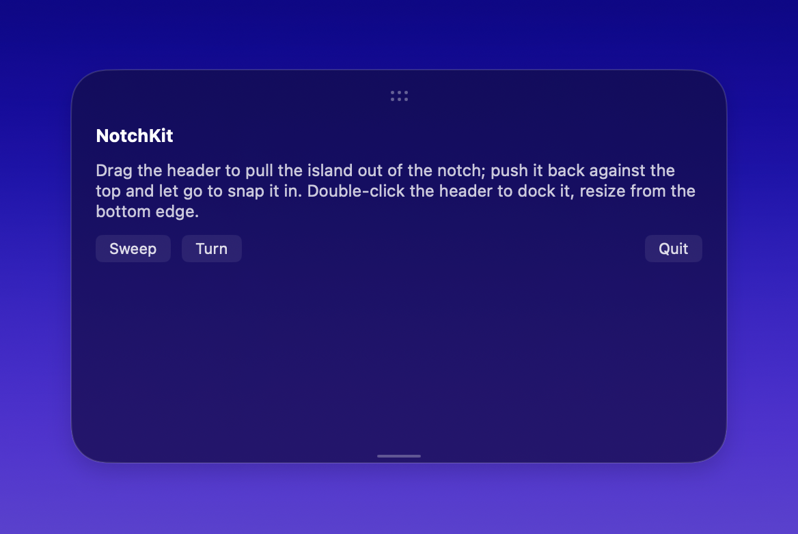
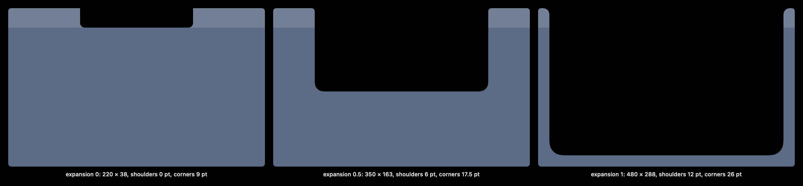
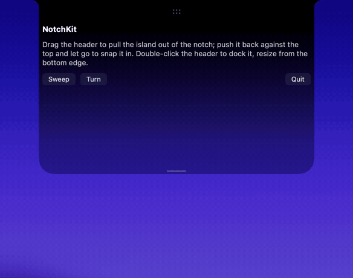

# NotchKit

[](https://github.com/neelrocketbots/notchkit/actions/workflows/ci.yml)

A chrome kit for a notch "island" on macOS: the black shape that grows out of a MacBook's notch, folds back into it, and can be pulled out as a floating card.

NotchKit draws and measures the island. Your app decides what goes inside it and when it opens.



## What's in it

- **Displays and notch geometry.** `NotchScreens.displays()` lists the connected displays in points (top-left origin). Each display has its kind: a hardware **notch**, a **Dynamic Island** camera cutout, or **plain**. On a notched display it also has the notch's size. `NotchGeometry.make(notch:…)` derives every size from the notch. On a plain display it uses a virtual notch.
- **The island's shape.** `NotchShape` has concave shoulders that flare into the menu bar, continuous bottom corners and an optional top radius. `NotchOutline` is an open path of the same edge, for strokes. `NotchPillShape` is the floating card and the folded pill.
- **Dock, float, drag and resize maths.** `NotchFloat` covers placement, clamping to the visible rect, cross-display lookup, the dock test and the VoiceOver corners. `NotchResize` covers the rubber band, Dock clearance and the VoiceOver step. `NotchLayoutPrefs` keeps the height and floating position per display, with tolerant decoding. `NotchHitRect` gives edge-inclusive hit tests.
- **Snap motion.** `NotchDockMotion` is a squash-and-stretch snap between docked and floating. It has the pull and push stretch and the spring.
- **Notch bleed.** A floating island dragged toward the notch takes in the notch's black from its top edge (`NotchDockMotion.bleed`, `ink`). `NotchBackdrop.overlayStops(…bleed:morph:)` draws it.
- **Glow.** `NotchGlowView` draws a gradient trace along the island's outline, with a blurred backlight. It can be off, turning (a lookup in progress) or sweeping (one pass for an event). It follows the notch, a plain display's strip or the pill, and has a Reduce Motion behaviour.
- **Frosted backdrop.** `NotchBackdrop` draws a dark material under a black overlay, so the notch band stays black. It draws solid under Reduce Transparency and Increase Contrast. Floating, it adds a frost tint, a border and `NotchFloatShadow`.
- **Grip and handles.** `NotchResizeHandle` is the bottom grab line. `NotchMoveGesture` and `NotchMoveArea` drag the island. `NotchGripDots` draws the ::: grip. The grip has VoiceOver actions: Dock and the four corners. All of them drive your model through `NotchHandleDriver`.
- **Configuration.** `NotchConfiguration`, read from the SwiftUI environment, sets colours, frost material and overlay, the floating look, handle inks, glow gradient and timing, accessibility strings and an optional glow calibration. The defaults reproduce the shipped look.



NotchKit reads no environment variables and no `UserDefaults`, and logs nothing. A client injects everything. A source-scan test guards this (`NotchKitSourceScanTests`).

## Requirements

- **macOS 26 or later.** This is the same floor as the app NotchKit was extracted from. The touch-display path also checks for macOS 27.
- Swift 6.2 toolchain (Xcode 26 or later).
- Swift Package Manager.

## Installation

```swift
// Package.swift
dependencies: [
    .package(url: "https://github.com/neelrocketbots/notchkit.git", from: "0.1.0"),
],
targets: [
    .target(name: "MyApp", dependencies: [.product(name: "NotchKit", package: "notchkit")]),
]
```

## Minimal usage

The smallest useful client puts a floating island in a borderless panel. It frosts the island, adds the shadow and the glow, and lets the user drag and resize it:

```swift
import NotchKit
import SwiftUI

struct FloatingIsland: View {
    let model: MyIslandModel                    // conforms to NotchHandleDriver

    var body: some View {
        let shape = NotchPillShape(cornerRadius: NotchFloat.cornerRadius)
        ZStack {
            NotchGlowView(state: model.glow, shape: .pill(cornerRadius: NotchFloat.cornerRadius),
                          on: true, reduceMotion: false)
            NotchBackdrop(shape: AnyShape(shape), rendering: .material,
                          height: model.geometry.expandedSize.height,
                          expandedHeight: model.geometry.defaultExpandedHeight, floating: true)
                .modifier(NotchFloatShadow(on: true))
            VStack(spacing: 0) {
                NotchMoveArea(driver: model).frame(height: model.geometry.notch.height)
                MyContent()
                NotchResizeHandle(driver: model)
            }
            .clipShape(shape)
        }
        .padding(NotchFloat.margin)            // room for the glow and the shadow
        // .environment(\.notchConfiguration, myConfiguration)   // optional: your colours and strings
    }
}
```

`NotchHandleDriver` is small:

```swift
@MainActor public protocol NotchHandleDriver: AnyObject {
    var geometry: NotchGeometry { get }
    var isMoving: Bool { get }
    var isFloating: Bool { get }
    func resize(_ input: NotchHandleInput)     // began / changed / ended / reset / step / cancel
    func move(_ input: NotchHandleInput)       // began / changed / ended / reset (dock) / corner / cancel
}
```

`Examples/NotchKitDemo` is a complete, runnable client: it starts docked under the notch, pulls out as a floating card when you drag its header, and snaps back when you push it against the top and let go. It has the panel, the driver and the "one frame owner" hosting:

```sh
swift run NotchKitDemo
swift run NotchKitDemo --floating       # start as the floating card
swift run NotchKitDemo --glow sweep     # or turn: light the glow from launch
swift run NotchKitDemo --snap           # float out and snap back, in a loop
```



## Building and testing

```sh
swift build
swift test
```

The tests use Swift Testing. They cover the geometry, shape, dock motion, bleed and ink, float rules, stored prefs, resize, hit rect, glow values and calibration, frost look and stops, shadow and grip. They also include the dependency source scan.

The figures in `docs/images` are rendered from NotchKit's own views and values by `swift run NotchKitDocImages`. Run it after a change to the geometry or the look, and commit the new PNGs.
The GIFs are recordings of `NotchKitDemo --snap`, `--glow sweep` and `--glow turn`, made with `screencapture -v` and ffmpeg.

### Releasing

Versions are git tags. To release `0.2.0`: in `CHANGELOG.md`, move the entries under `## [Unreleased]` to a new `## [0.2.0] - YYYY-MM-DD` heading, merge that, then tag and push:

```sh
git tag -s v0.2.0 -m "v0.2.0"
git push origin v0.2.0
```

The Release workflow runs the tests, takes that section of the changelog as the notes, appends the merged pull requests by label (`feature`, `fix`, `docs`) and publishes the GitHub Release. A tag with a suffix, such as `v0.2.0-beta.1`, is marked a pre-release.

## Documentation

- [docs/Architecture.md](docs/Architecture.md): the modules, what NotchKit owns and what the client owns, and the invariants.
- [docs/Configuration.md](docs/Configuration.md): every `NotchConfiguration` field and its default.
- [docs/Geometry.md](docs/Geometry.md): sizes, display kinds, docking, floating, resize, snap, bleed, glow and frost. These are the behaviour rules, with numbers.
- [CHANGELOG.md](CHANGELOG.md)

## Status

NotchKit was extracted from a macOS app whose live surface is a notch island. This repository holds the first three extraction steps: the displays, the pure maths and the look. Its git history is the history of those steps.

Coming next, in this order:

1. **Controller**: a `NotchController` with the island's generic state (hover dwell and leave grace, placement, grip, stretch and bleed, prefs, the hover target) and one event stream.
2. **Panel**: an `open class NotchPanel` that owns the frame, the hover-target panel, pointer monitors, drag/dock/resize handling and display following.
3. **Surface and content slots**: a `NotchContent` protocol (folded leading/trailing, header, body, idle) laid out by NotchKit, with the layout-fault guards built in.
4. A fuller demo and screenshots.

Until those land, a client owns its panel and its state, as `Examples/NotchKitDemo` shows.

## License

MIT. See [LICENSE](LICENSE).

## Open decisions

- **Naming.** The package and its types use `Notch…`. The docs and some defaults still say "island", for example the VoiceOver strings "Island height" and "Move island".
- **Defaults.** The default look is the source app's: coral-to-marigold glow and its sizes. A neutral default may suit a public library better.
