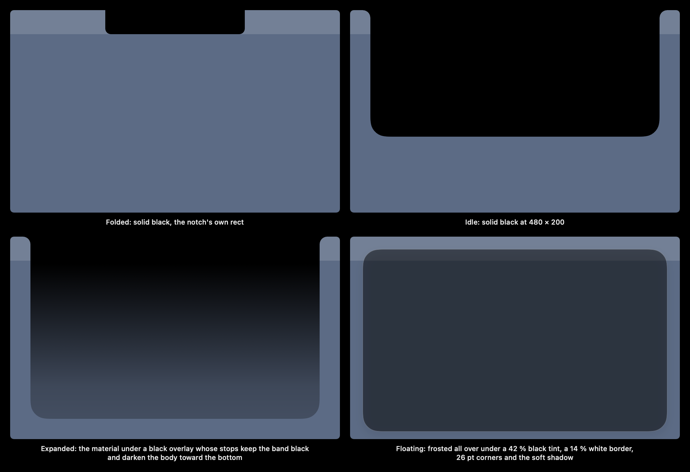
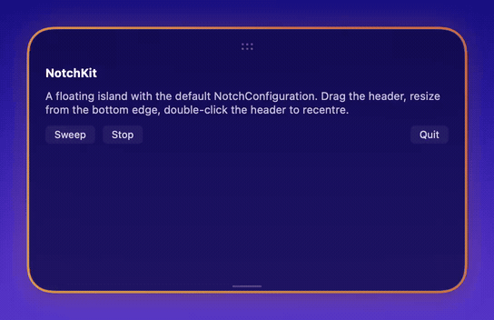

# Configuration

`NotchConfiguration` holds what a client tells NotchKit about its island's look, words and timing. Every default reproduces the look NotchKit shipped with. A client sets only the fields that differ.

NotchKit's views read the configuration from the SwiftUI environment:

```swift
var config = NotchConfiguration()
config.appearance.glow = .init(start: NotchColor(hex: 0x4F8BD9), end: NotchColor(hex: 0x5AE0F2))
config.strings.height = "Panel height"
config.motion.glowSweep = .milliseconds(1200)

MyIsland()
    .environment(\.notchConfiguration, config)
```

NotchKit reads no environment variables and no `UserDefaults` of its own. A client's debug switches arrive through `NotchConfiguration.debug` too.

## Colour types

- `NotchColor(r:g:b:a:)` or `NotchColor(hex:alpha:)` is an sRGB colour. Its `.color` is the SwiftUI `Color`.
- `NotchStop(location, opacity)` is one stop of the black overlay. `location` is a fraction of the expanded island's height from the top. `opacity` is black's opacity there.
- `NotchShadow(color:radius:x:y:)` is a drop shadow.
- `NotchFrostMaterial` is `.ultraThin`, `.regular` or `.thick`.

## `appearance`



| Field | Default | What it is |
|---|---|---|
| `fill` | `#000000` | The island's own fill: the notch's black. The folded and idle islands, the notch band and the solid body use it. |
| `frost.tint` | rgba(18, 18, 20, 0.12) | The material's stand-in in an offscreen render, which cannot see behind its window (`NotchBackdrop.Rendering.tint`). |
| `frost.overlay` | `(0, 1) (0.15, 1) (0.82, 0.253) (1, 0.187)` | The black overlay over the material. It is solid down to 15 % of the expanded height (the band under the notch), then ramps. The two lower values are 0.46 and 0.34 times 0.55. |
| `frost.material` | `.ultraThin` | The SwiftUI material, drawn in the dark scheme. |
| `floating.overlay` | 0.42 | The floating island's flat black tint over the material. |
| `floating.border` | white at 14 % | The floating island's 1 pt border. |
| `floating.shadow` | black at 16 %, radius 8, y 6 | The floating island's soft shadow (`NotchFloatShadow`). |
| `handle.lineRest` / `lineHover` | white at 28 % / 70 % | The resize grab line, at rest and lit. |
| `handle.gripRest` / `gripHover` | white at 35 % / 85 % | The ::: move grip, at rest and lit. |
| `glow.start` / `glow.end` | `#D9704F` / `#F2B65A` | The glow's gradient, start → end → start round the island. |
| `glow.offOutline` | 0.85 | The white's opacity of the plain outline drawn in place of the glow when the client turns the glow off (`NotchGlowView(on: false)`). |

## `strings`

These are the words NotchKit's own controls speak, as VoiceOver labels, values and actions.

| Field | Default | Used by |
|---|---|---|
| `height` | "Island height" | The resize handle's adjustable element. |
| `heightUnit` | "points" | Its value, e.g. "288 points" (`heightValue(_:)`). |
| `move` | "Move island" | The move grip's element (`notchMoveGripAccessibility`). |
| `dock` | "Dock" | The grip's dock action, shown while floating. |
| `topLeft`, `topRight`, `bottomLeft`, `bottomRight` | "Top Left" … | The grip's corner actions (`corner(_:)`). |

## `motion`



| Field | Default | What it is |
|---|---|---|
| `glowSweep` | 1.6 s | One sweep of the glow once round the island. |
| `glowTurn` | 6 s | One full turn of the glow while it is turning. |

The snap spring (response 0.32, damping 0.62) is `NotchDockMotion.snapSpring(slowdown:)`. Pass a `slowdown` above 1 to slow it for frame captures.

## `debug`

| Field | Default | What it is |
|---|---|---|
| `glowCalibration` | `nil` | When set, the glow is lit steadily, and its folded outline is moved by the `NotchGlowCalibration` this closure returns. The closure is read twice a second, so a by-eye match to the physical notch updates live. The calibration fields are `inset`, `widthDelta`, `heightDelta`, `xOffset`, `yOffset` and `bottomRadius`. |

## What is not configurable yet

The sizes and the behaviour constants are still `static let`s on the types:

- sizes: `NotchGeometry.extraWidth/extraHeight/idleHeight/earWidth`, `NotchFloat.pillSize/cornerRadius`
- behaviour: `NotchFloat.dragThreshold`, `NotchDockMotion.dockReach`, `NotchResize.rubberBand/dockClearance/step`
- hit testing: `NotchHitRect.margin`

`docs/Geometry.md` lists them all. The floating pill's size is already a parameter on the `NotchFloat` functions that use it (`pillSize:`). The others are planned to move into `NotchConfiguration.metrics` and `.behaviour` along with the controller.

## Backdrop rendering

The `notchBackdrop` environment value (`NotchBackdrop.Rendering`) says how a host draws the body:

- `.material`: the real blur. Use it in the island's own panel.
- `.tint`: the frost's tint. Use it for offscreen renders and snapshot tests.
- `.solid`: black. This is the default, for every other host, such as a preview inside a normal window.
