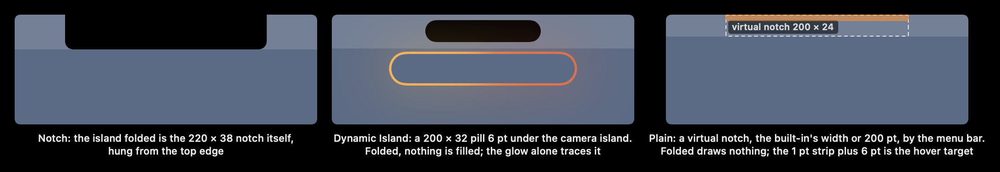
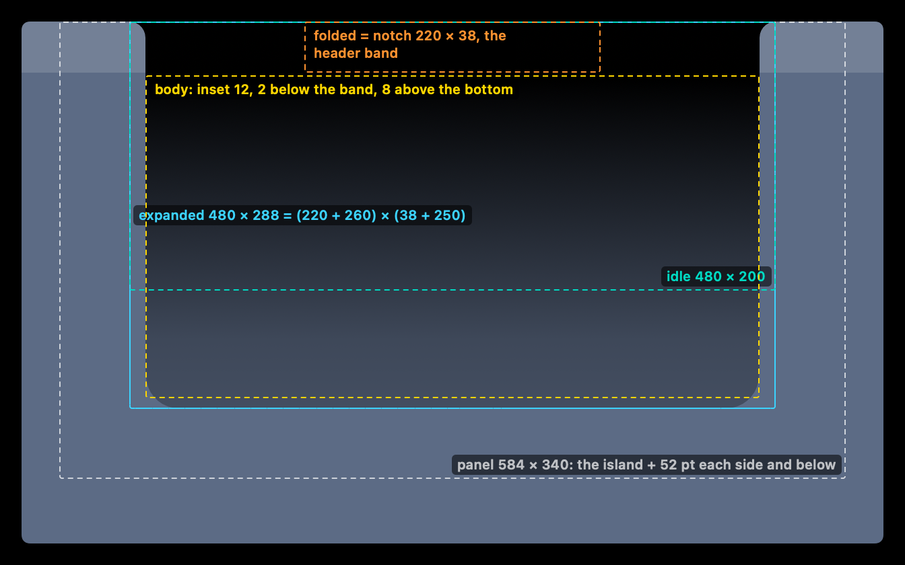
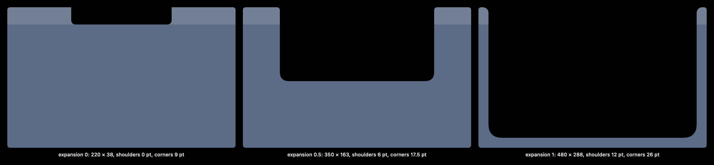
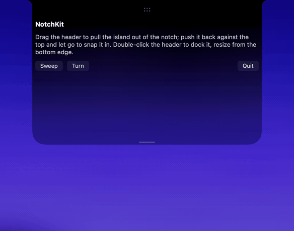
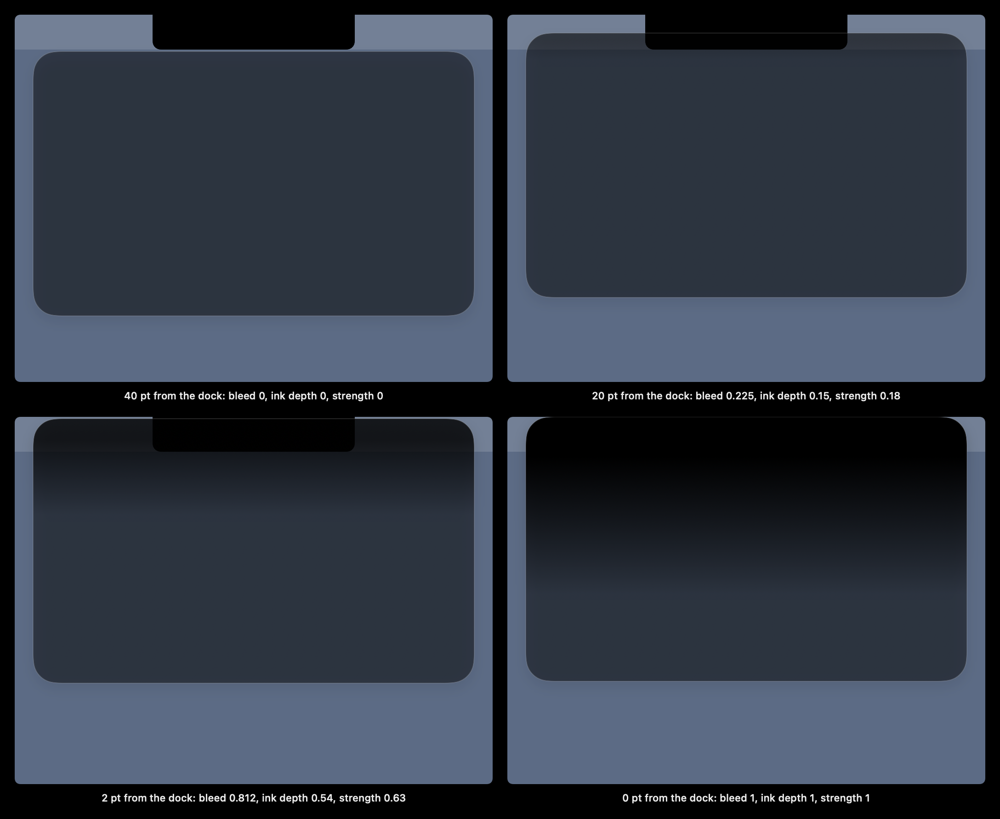
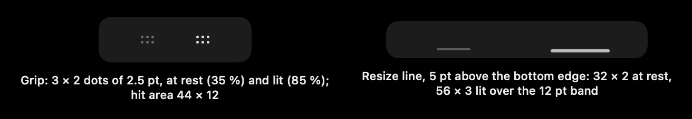
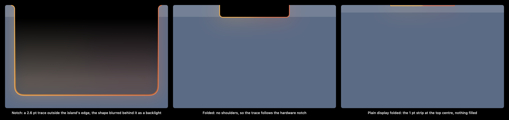
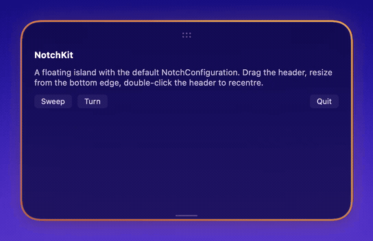
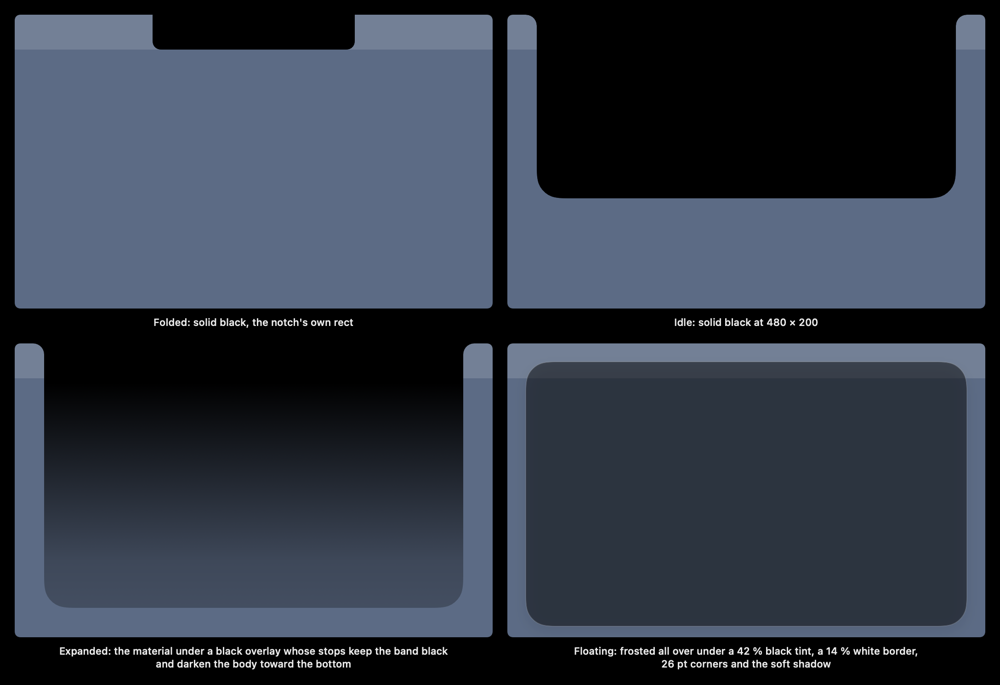

# Geometry and behaviour

These are the rules NotchKit's types encode, with their numbers. They were written as behaviour rules in the source app, and the tests in `Tests/NotchKitTests` check them. The "Client" notes mark what NotchKit leaves to the app until the controller and panel land (see the README's Status).

Coordinates: `NotchDisplay` frames use points with a top-left origin at the main display. Island rects are in the panel's content, also top-left. `NotchHitRect.screenRect(of:inPanel:)` converts one to AppKit screen coordinates (bottom-left).

## Displays

`NotchScreens.displays(measured:)` reads every `NSScreen`:

- frame, `isMain`, `isBuiltIn`
- the menu bar's height: the larger of the menu bar and the safe area's top
- touch: `multiTouch`, on macOS 27 and later
- the Dock and side insets: `NotchVisibleInsets`, which give `visibleRect`
- on a notched display, the notch: the screen's width less both auxiliary top areas, by the safe area's top

The optional `measured` callback gets each notch's raw values, for a client's calibration log.

`NotchDisplayKind.classify` applies one rule, in order:

1. An external display is **plain**, touch or not.
2. A built-in touch display is a **Dynamic Island** display.
3. A built-in display whose safe area is not split by a notch-wide gap is a Dynamic Island display too. A gap is notch-wide at 100 pt or more; real notches measure 185 to 220 pt.
4. A built-in display with that gap has a **notch**.
5. Anything else is plain.

## Sizes derived from the notch (`NotchGeometry`)

Every size comes from the notch:

| Size | Value |
|---|---|
| Notch | The hardware notch. A plain display gets a virtual notch: the built-in's notch width, else 200 pt, by the menu bar's height. The menu bar's height is floored at 24 pt, because a hidden menu bar reads 0. A Dynamic Island display gets a 200 × 32 pill, 6 pt below the menu bar. |
| Folded | The notch rect exactly. Its 9 pt bottom corners sit inside the hardware's own. |
| Expanded | (notch width + 260) × (notch height + 250). A touch display adds 26 pt each side. |
| Idle | (notch width + 260) × 200. |
| Panel | The expanded island plus 52 pt (glow outset 8 + blur 24 + overshoot 20) on each side and below it. `panelSize(growth:)` adds the client's growth. |
| Header band | The notch's height. |
| Body | Inset 12 pt from the island's outer edge, from 2 pt below the band to 8 pt above the bottom (`bodyRect`). |

The corners and shoulders change with the expansion e, from 0 (folded) to 1 (expanded):

- Bottom corners: `9 + 17e`, so 9 to 26 pt.
- Concave shoulders: `12e`. Folded has none, so the glow traces the hardware notch.
- The Dynamic Island pill: `16 + 10e`.

A shape nested inside another takes the outer radius less the gap between their edges, at least 6 pt (`nested(outer:inset:)`). Capsules stay capsules.

On a touch display every control's hit area is at least 36 pt, round its unchanged drawing (`hitSize(_:touch:)`).

Where the island hangs:

- Under a notch, and on a plain display, the island is centred and hung from the top.
- On a Dynamic Island display it sits at the centre, or 12 pt from the left or right edge (`NotchDockPosition`).
- The hover target is the notch rect, or the pill. On a plain display it is a 1 pt top-centre strip plus 6 pt below it.

## The shape (`NotchShape`)

`NotchShape(shoulder:bottomRadius:topRadius:)` draws the island:

- It is a rectangle hung from the top edge, with continuous bottom corners.
- Concave shoulders flare out into the top edge. They are drawn inside the rect, so the body's inset clears them.
- `topRadius` rounds the top corners during a snap.

`outline(in:)`, and `NotchOutline`, give the same edge as an open path, without the top edge, for the glow's trace. `NotchPillShape(cornerRadius:)` is the floating card, and the pill folded.

## Hit testing (`NotchHitRect`)

The panel is larger than the island, to leave room for the glow and the spring's overshoot. It takes the mouse only over the drawn island plus 6 pt. Everywhere else, clicks and scrolls reach the app below.

The test is edge-inclusive on every side, unlike `CGRect.contains`, which leaves out `maxX` and `maxY`. The collapsed hover target's top edge is the screen's top edge, so a pointer pushed against the top of the screen must count.

While the island is open, a pointer on the folded hover target still counts as hovering. This keeps a pointer held on the notch row from starting the leave grace.

## Resize (`NotchResize`, `NotchResizeHandle`)

- **Grab line.** It sits 5 pt above the bottom edge: 32 × 2 at rest, and 56 × 3 lit over the bottom 12 pt band, with the up-down resize pointer.
- **What changes.** Dragging changes the expanded height alone (`resized(toHeight:)`). The panel and the body follow, and the top stays fixed.
- **Minimum.** The client's minimum. Below it the edge gives a rubber band of at most 12 pt, an exponential approach, and springs back on release. Under Reduce Motion there is no band.
- **Maximum.** 80 pt clear above the Dock, or above the display's bottom edge (`maxHeight(top:display:min:)`).
- **Double-click.** Back to the default height, notch + 250 (`defaultExpandedHeight`).
- **VoiceOver.** The adjustable `strings.height` element, ±40 pt a step.
- **Floating at the bottom.** A floating island whose bottom edge sits on the visible rect's bottom can only grow upward. Its handle moves to the top edge (`NotchResizeHandle(top: true)`).

Client: compute the limits and apply the height (`NotchHandleDriver.resize`).

## Drag, float and dock (`NotchFloat`, `NotchMoveGesture`)

- **Detach.** A drag on the grip or on the header's empty space moves the island. It detaches after 6 pt (`dragThreshold`), so a click is still a click.
- **Floating.** The island has no shoulders, four 26 pt corners, and frost all over. It is kept inside the display's visible rect (`clamp`), below the menu bar and clear of the Dock. It follows the pointer onto another display (`display(at:in:)`).
- **Docking.** It docks only when released with its top edge against the screen's top over the notch (`touchesDock`). A double-click on the grip or on the header docks it (`.reset`).
- **VoiceOver.** "Move island" has Dock, while floating, and the four corners. A corner sits 16 pt in from the visible rect's edges (`anchor(corner:size:visible:)`).
- **Folded while floating.** The island folds to a 132 × 30 pill. The pill's corner goes from a capsule to 26 pt as it opens (`NotchFloat.cornerRadius(expansion:)`). It opens downward, or upward near the bottom: the expanded rect is clamped on screen and the geometry's `pillOffset` keeps the pill where it was.
- **Saved per display.** `NotchLayoutPrefs` keeps the height and the floating position by display id. The position is stored as fractions of the visible rect (`NotchOrigin`), so it survives a resolution change. Decoding from the string-keyed maps a client stores never traps (`init(storedHeights:storedOrigins:)`). It skips any entry whose key is not a canonical display id, and any height that is not finite, positive and at most 100,000. It clamps origin fractions into 0…1.

Client: hold the drag state and move the panel (`NotchHandleDriver.move`).

## Snap motion (`NotchDockMotion`)

The snap is a squash and stretch.

- **Stretch while dragged.** The island stretches toward the notch, up to 0.96 × 1.06 about its top, and never more than 12 pt taller. A docked island stretches as the pointer pulls toward the 6 pt detach (`pullStretch`). A floating island stretches as its top is pushed into the last 40 pt above the dock (`pushStretch`).
- **At the flip.** The shape takes the new placement at once. A floating island has no shoulders, so the docked shape never shows at the floating spot.
- **Spring.** The shape springs into the new placement with spring(response 0.32, damping 0.62):
  - The top corners go from 6 pt to the card's radius when floating, or to a square top with the shoulders growing back when docked (`outline(floating:expansion:morph:)`).
  - The frost and the shadow fade in, over the notch's black.
  - The stretch springs back with an overshoot.
- **What moves.** Only the island's own SwiftUI view animates. The panel's frame moves at once, under its single owner.
- **Reduce Motion.** Instant.

## Notch bleed

A floating island dragged toward the notch takes in the notch's black from its top edge:

- **Bleed.** `bleed(proposedTop:dockTop:)` is the top edge's proximity over the last 40 pt, eased in (squared) and capped at 0.9 until contact. 20 pt away it is 0.225. It reaches 1 only at contact, where the island docks on release.
- **Where.** The client sets it only while the island overlaps the notch, or a plain display's strip, horizontally.
- **Ink.** `ink(bleed:)` gives the ink's depth and strength. At the cap these are 60 % of the docked band's depth and 70 % of the way from the floating tint to black. Between the cap and contact they grow on continuously to the full docked look, so the view's spring at contact never pops.
- **Stops.** `NotchBackdrop.overlayStops(height:expandedHeight:floating:bleed:morph:)` draws the docked band and its ramp at that depth and strength over the floating tint, never lighter than the tint. At contact the top is the docked band. The snap morphs from that into the docked gradient. A settled docked island draws exactly the docked stops.
- **Leaving.** Pulled out, the ink drains as the island leaves. At a drag's end it springs back to none.
- **Reduce Motion and Reduce Transparency.** Under Reduce Motion there are only two states, none and full at contact, with a 200 ms fade. Reduce Transparency draws the body solid, unchanged.

## Grip (`NotchGrip`, `NotchGripDots`)

- **Look.** 3 × 2 dots, 2.5 pt with 2.5 pt gaps, at 35 % at rest and 85 % lit. The hit area is 44 × 12.
- **Floating.** The grip sits in the header's middle and is always shown.
- **Docked.** It hides behind the notch, up inside the band. It slides down below the band while the pointer is on the notch's region (`dockedTop(band:shown:reduceMotion:)`).
- **Reduce Motion.** It fades in place instead of moving.
- **The folded pill.** The pill shows the same dots as a hint, with no target of its own.

## Glow (`NotchGlow`, `NotchGlowView`)

- **What it draws.** A 2.6 pt gradient trace (start → end → start) along the outline, outside the island's edge. Behind it, the island's own shape is blurred as a backlight.
- **Backlight.** Expanded: 8 pt out, 24 pt blur. Folded: 10 pt out, 32 pt blur, a little wider and softer. In between it interpolates with the expansion. Its opacity is 30 %, and 35 % while turning.
- **States.** Off draws nothing. Turning goes round once every 6 s, redrawn at 30 fps. A sweep runs once round in 1.6 s, redrawn at 60 fps, and each new serial restarts it. A sweep that starts during a turn carries on from the turn's angle. When its state ends, the glow fades out over 200 ms.
- **Shape.** The glow follows the notch island's edge, a plain display's folded 1 pt strip, or the pill: on a Dynamic Island display, or floating (`NotchGlowShape.of(_:expansion:)`).
- **Glow turned off.** If the client turns the glow off, a plain white outline (85 %) is drawn for the same moments.
- **Reduce Motion.** No turning, and a sweep shows still at full.
- **When to glow.** NotchKit has no hover or scroll input for this. The client decides.

## Frosted backdrop (`NotchBackdrop`)

The expanded island's body is the frosted island:

- **Material.** The configured SwiftUI material, in the dark scheme, under the black overlay. The notch band stays black, and the body below it is a light frost that darkens toward the bottom.
- **The overlay stays put.** Its stops sit at fractions of the default expanded height. While the island grows they stay at those heights, so the band stays black.
- **Solid states.** The folded and idle islands are solid black.
- **While folding.** A fold out of the expanded island stays frosted while the animated expansion is above 0 (`look(drawn:lastOpen:expansion:…)`). Only the fully folded notch is solid.
- **Floating.** Frosted all over, folded pill included, under a flat 42 % black tint. No band, a white 14 % border, and the soft shadow (`NotchFloatShadow`, always applied so the fill keeps one identity across a flip).
- **Reduce Transparency or Increase Contrast.** The body is solid black, with no shadow.

This is NotchKit's only material. A test scans the sources to keep it that way.

**The behind-window blur.** The blur is SwiftUI's material. In a clear, non-activating panel it blurs what is behind the window. An `NSVisualEffectView` with `.behindWindow` blending drew flat in the same panel.

**Offscreen renders.** These cannot see behind their window. Use `.tint` for snapshots, and check the real blur by eye.
